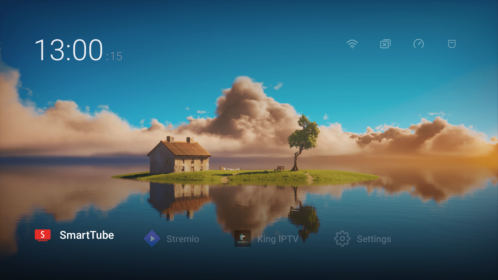

# Anti-Israeli Spyware TV Launcher 🛡️📺

An ultra-minimalist, zero-telemetry, bloat-free native Android TV launcher engineered for speed, privacy, and aesthetic perfection. Built from scratch with pure Kotlin and modern Android framework APIs.



---

## ⚡ Features

- **Zero Bloat & Zero Telemetry**: Under 500 KB total APK size. Stripped of all background analytics, vendor spyware, and unwanted Google TV ad recommendations.
- **Pure Frosted Glassmorphism**: Authentic iOS-style real-time background blur with Gaussian stack-blur and `RenderEffect` hardware shaders, specular cut-glass rims, and smooth squircle corners.
- **Built-in Wi-Fi Controller**: Instant frosted side panel for Wi-Fi management with backward compatibility across Android 14 (`targetSdk 28` bypass).
- **Hardware TV Input Switcher**: Global remote button interception for TV inputs with a floating translucent top switcher bar (HDMI 1, HDMI 2, HDMI 3, AV, TV Antenna).
- **RAM Cleaner & App Killer**: One-click RAM optimization and background process killer right from the top bar.
- **Quick Dock**: Instant zero-latency Leanback launch for your essential media apps (SmartTube, Stremio, King IPTV, Settings).
- **Cinematic Visuals**: 4K wallpaper rendering with subtle cinematic vignette overlays and soft digital clock.

---

## 🚀 Building & Installing

### Prerequisites
- Android SDK (compileSdk 34)
- Gradle 8.9+
- JDK 17

### Build Release APK
```bash
gradle assembleRelease
```

The compiled APK will be located at:
`app/build/outputs/apk/release/app-release.apk`

### Install to TV via ADB
```bash
# Connect to your Android TV
adb connect <TV_IP>:5555

# Install APK
adb install -r app/build/outputs/apk/release/app-release.apk

# Enable accessibility service for remote TV Input button interception
adb shell settings put secure enabled_accessibility_services com.d4cx.tvlauncher/.InputKeyInterceptService
adb shell settings put secure accessibility_enabled 1
```

---

## 📄 License
MIT License
